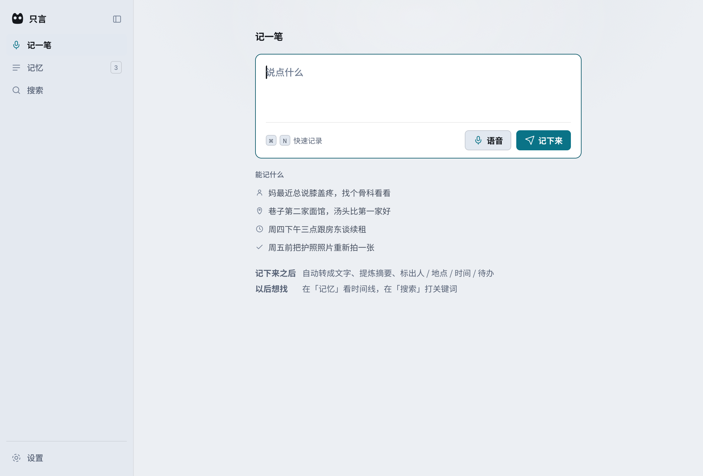
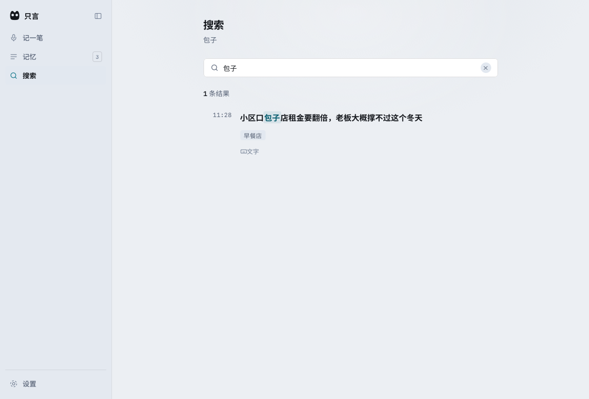
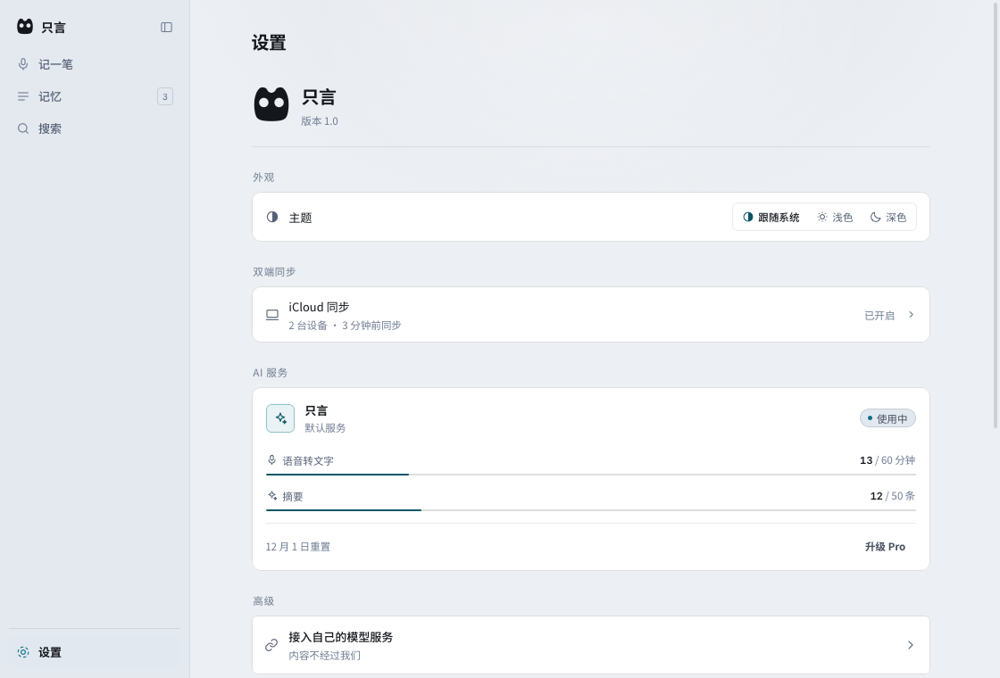

# 只言 ZhiYan

**一款为中文场景做的语音 + 文字记忆 App，跑在 macOS 和 iOS 上。**
说出来或打下来一次，之后一直搜得到，数据始终留在你自己设备里。

[English](README.md) · **简体中文**

`macOS` `iOS 模拟器` `Swift + WKWebView` `SQLite3 / FTS5` `零第三方依赖`

---

## 进展

v0.5。数据链路是**真的**：记下来的东西会落盘、重开还在、能用中文搜回来。

### 已经能用的

| 功能 | 怎么验的 |
|---|---|
| 文字记录写进 SQLite | 退出重开，数据还在 |
| 中文全文检索，**1 个字、2 个字**也能搜 | `selftest`，11 项断言 |
| 真录音存成本地 `.m4a` | `rectest`，6 项断言；AAC 单声道 44.1 kHz、2.0 秒、含真实环境音 |
| 导出 Markdown 与 JSON 文件 | 两种都实际生成并检查过 |
| 标签和摘要可检索 | `selftest` 断言了「只靠标签命中」 |
| 首次打开是空库，不是演示数据 | 用干净安装实测确认 |

自动化覆盖：**43/43** 数据层断言、**11/11** 检索断言、**6/6** 录音断言。

### 没做的

直说，因为一份藏掉缺口的清单对谁都没用。

| 功能 | 状态 | 原因 |
|---|---|---|
| 语音转写 | **没做** | 依赖云端服务商和已备案的生成式 AI。录音原样存下，标记为「待转写」 |
| AI 摘要 / 自动打标 | **没做** | 同一个卡点 |
| iCloud 双端同步 | **没做** | 界面画了，背后没有逻辑 |
| iOS 真机包 | **没做** | 需要 provisioning profile，需要 iPhone 连到构建机 |
| 横屏 | **没做** | 只有竖屏 |
| App Store 上架 | **没做** | ad-hoc 签名，未公证 |

这一版验证的是**记录 → 检索 → 导出**这条主干，以及中文短查询检索的可行性。
AI 链路和同步都还没接。

---

## 界面

| macOS | iOS 模拟器 |
|---|---|
|  |  |
|  |  |
|  |  |
|  | |

---

## 三个值得说明的决定

### 界面用 `WKWebView` 装 HTML，不是 SwiftUI

这个界面在做成这一版之前经历了三轮审美返工。改成 SwiftUI 意味着把这些工作逐像素重做一遍，
而且拖得越久越贵。`prototype/` 里的 HTML/CSS 原样保留，渲染结果完全一致；
数据层也隔离在一个小接口后面——将来要搬去 SwiftUI，重写 `build/Data.swift` 一个文件就行，
不是重写整个 App。

代价是真实的：多背一个 WebView 运行时，拿不到平台的原生控件。这一版我认为这笔交易划算。

### 数据层直接调 SQLite3，不用 ORM

`build/Data.swift` 直接调系统 SQLite3 的 C API。没有 GRDB，没有 Core Data，
没有 SwiftData，没有 SPM 依赖，没有 CocoaPods。整条工具链就是 `swiftc` + 平台 SDK。

用 GRDB 会写得更快，本身也是好选择。不用的原因是：零依赖的构建链始终可审计、足够小，
而且这个选择只隔着一个缝，反悔成本固定。

### 中文检索需要两张 FTS5 表 —— 而最直觉的解法是静默失效的

SQLite 的 `unicode61` 分词器会把一整串汉字当成**一个 token**。`包子店` 变成单个 token，
于是查 `包子` 这种两字查询返回 0 行。

最直觉的修法——「短查询用 unigram 兜底」——如果你原样把 `unicode61` 喂进去，是**不成立**的。

真正可行的是：写入 unigram 表之前，逐字插空格（`包 子 店`），纯西文不插。
检索时按词长分流：

| 查询 | 走哪张表 | 合并方式 |
|---|---|---|
| 1–2 字 | unigram | — |
| 3 字及以上 | trigram（主查）+ unigram | 并集 |
| 多词 | 两张都走 | 交集（AND） |

两条容易漏、而且都是靠实测才发现的约束：

- unigram 表必须**同时索引标签和摘要**，不能只索引正文。否则一条标签写着 `咖啡`、
  正文里从没出现过咖啡的记录，搜「咖啡」是搜不出来的。
- 空值必须绑成 SQL `NULL`，不能绑成字符串 `"nil"`。Swift 里 `nil as Any` 得到的是
  `Optional<String>.none`，它既不匹配 `NSNull` 也不匹配 `String`，
  最后掉进 `String(describing:)`——把字面量 `"nil"` 六个字符写进了数据库。

---

## 架构

```
prototype/            HTML + CSS + JS —— 整个界面
  app.js              视图、状态、交互
  base.css            设计变量与版式
  db.js               ZY 模块：调原生壳，无壳时退回内置假数据
  data.js             演示数据，仅在浏览器里预览时使用
        │
        │  window.zyNative.call({ op, ...payload })  →  Promise
        ▼
build/shell.swift     WKWebView 宿主
                      WKScriptMessageHandler  （通道名 "native"）
                      AVAudioRecorder          （真录音，存 .m4a）
                      AVAudioSession           （iOS 麦克风权限）
        │
        │  op: load · save · delete · search · stats
        │      export · rebuild · wipe · seed
        │      recStart · recStop · recCancel · micPerm · log · dump
        ▼
build/Data.swift      SQLite3 C API
                      notes · notes_fts_trigram · notes_fts_unigram
                      三种写操作的触发器，由 SQLite 自己保持一致
        ▼
notes.db
```

```
notes.db
├── notes                    全部记录，含软删除（deleted = 1）
├── notes_fts_trigram        3 字以上中英文，原生 FTS5
├── notes_fts_unigram        逐字插空格 —— 短查询走这张
└── trg_notes_ai / _au / _ad 每次写入自动触发
```

---

## 从源码构建

需要 Apple Silicon 的 Mac 和 Xcode 命令行工具（在 Xcode 26.2 上开发验证）。
没有包管理步骤——因为没有任何依赖要装。

```bash
git clone https://github.com/Eileenes/zhiyan-notes.git
cd zhiyan-notes

./build/build.sh test     # 编译并跑数据层 —— 期望 43/43
./build/build.sh all      # 双端编译、签名、打 DMG
```

| 目标 | 产物 |
|---|---|
| `build.sh mac` | `dist/只言.app`、`dist/只言.dmg` |
| `build.sh ios` | `dist/ZhiYan-sim.app`（arm64 模拟器） |
| `build.sh test` | 只跑数据层断言 |

脚本对每一步都做校验，而不是相信它：Web 资源进包后逐个比对哈希、二进制进包后比对
`LC_UUID`、模拟器包检查 `IOSSIMULATOR` 平台标记、两端都跑 `codesign --verify --strict`。

> 这个校验是被一个真实的坑逼出来的：一次构建可以编译成功、签名成功、安装成功、
> 启动成功、日志一切正常——**跑的还是上一次的二进制**，因为重新编译出来的文件
> 从来没被拷进 bundle。症状是「我明明改了却什么都没发生」，而且没有任何报错。

### iOS 签名有一个坑

```bash
codesign --force --sign - ... --options runtime   # macOS：正确
codesign --force --sign - ...                    # iOS 模拟器：不能加 runtime
```

模拟器包**绝对不能**加 Hardened Runtime。加了之后 `codesign --verify` 通过、
`hdiutil verify` 通过，App 一进模拟器启动就崩在
`DYLD_ROOT_PATH not set for simulator program`。只有真的启动一次才抓得住。

---

## 自己验，而不是靠假设

App 内置三套自检，在页面里调**真实**原生桥接，不走 mock。

```bash
./dist/只言.app/Contents/MacOS/只言 --act selftest   # → RESULT=PASS（11/11）
./dist/只言.app/Contents/MacOS/只言 --act rectest    # → RESULT=PASS（6/6）
./dist/只言.app/Contents/MacOS/只言 --act probe      # 页面几何诊断
```

> 可执行文件名叫 `只言`，多数 shell 里需要加引号。

`selftest` 覆盖：落库条数、1 字查询、2 字查询、3 字查询、西文查询、只靠标签命中、
多词 AND 该命中、多词 AND **不该命中**、统计、导出。
两个反向断言才是关键——正是它们排除了「其实只是字符串匹配」。

`rectest` 覆盖：录音时长 > 1 秒、返回文件路径、记录落库、音频路径一起存下、
状态为「待转写」、导出落在预期目录。

完整走查：**[docs/INSTALL.zh-CN.md](docs/INSTALL.zh-CN.md)** ·
**[docs/INSTALL.md](docs/INSTALL.md)**

---

## 数据与隐私

**数据完全不出设备。** 没有网络代码、没有账号、没有服务器、没有埋点、没有崩溃上报。

| 平台 | 位置 |
|---|---|
| macOS | `~/Library/Application Support/只言/notes.db` |
| macOS 媒体 | `~/Library/Application Support/只言/media/`（录音、导出文件） |
| iOS | App 容器 → `Documents/只言/notes.db` |

设置页底部会实时显示这个路径。删 App 不会删数据，删那个目录才会。

---

## 目录结构

| 路径 | 是什么 |
|---|---|
| `build/Data.swift` | 建表、FTS5、查询、导出——整个数据层 |
| `build/shell.swift` | WKWebView 宿主、JS 桥接、录音 |
| `build/build.sh` | 编译、打包、签名、校验 |
| `build/tests/` | 43 项数据层断言 |
| `prototype/` | 界面源码。目录名叫 prototype 是历史遗留，它就是现在在用的界面 |
| `icon/` | 图标源文件与导出 |
| `docs/screenshots/` | 上面用到的 8 张截图 |
| `PRODUCT-PLAN.md` | 产品方案 v3.3（中文） |

`prototype/` 虽然叫这个名字，但它是壳实际打包进去的界面源文件。
改名要动 `build.sh` 里每一处路径，所以留着了，没有为了整洁去折腾。

---

## 后面要做的

决定这个项目有没有未来的三件事，目前一件都没做。

1. **语音转写与 AI 摘要。** 这才是真正的差异化。现在一段录音只是一个标着「待转写」的音频文件。
2. **手机与 Mac 的同步。** 双端产品的地基。CloudKit 和自建服务器互斥，
   CloudKit 还会把产品绑死在 Apple 平台上。**这个决定现在是有意留空的。**
3. **「不依赖厂商」这个卖点。** 它只有在 iCloud 不可用的地方才成立。
   所以它是第 2 条的结论，不是独立功能。

这三件落地之前，v0.5 是一个能用的记录-检索闭环，不是一个有差异化的产品。
这一点我们选择直说。

---

## 文档

- **[docs/INSTALL.zh-CN.md](docs/INSTALL.zh-CN.md)** — 安装、数据路径、自检命令
- **[docs/INSTALL.md](docs/INSTALL.md)** — Install & verification guide (English)
- **[PRODUCT-PLAN.md](PRODUCT-PLAN.md)** — 完整产品方案 v3.3（中文）

产品方案里记了一次修正：原检索方案写的是「unigram 表负责 1-2 字中文兜底」。
按这个实现之后实测发现，用 `unicode61` 根本不成立。
第 3.6 节记录了试过什么、数字是多少、最后换成了什么做法。