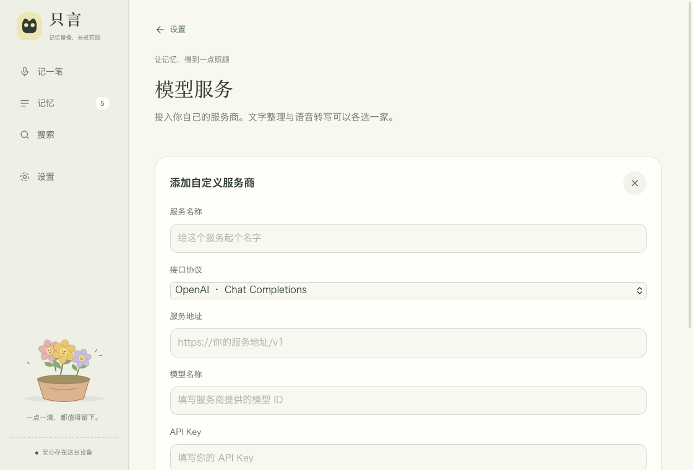
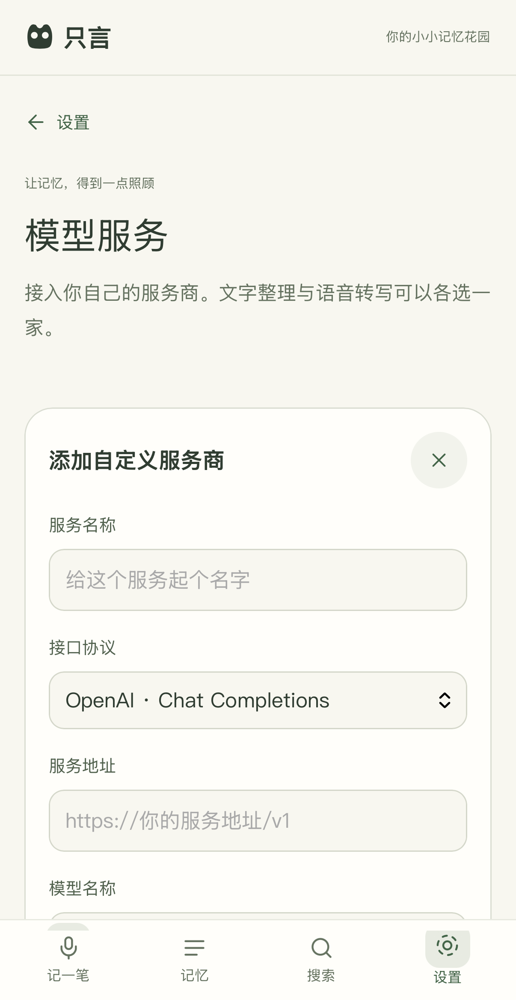

# v0.7：模型服务与多端同步

更新：2026-10-13。目标为面向多用户的 iOS、macOS、Windows、Android 记忆应用。

## 已实现

- 设置 → **模型服务**：自定义服务名称、Base URL、模型 ID、API Key，选择 OpenAI Chat Completions / OpenAI Responses / Anthropic Messages；可保存多个服务、指定默认服务、停用及删除。测试按钮会发送真实请求并显示错误。
- 独立 OpenAI 兼容语音转写配置。详情页发起转写、摘要与标签任务；任务持久化、失败可重试，中断可恢复。转写和 AI 标签单独保存，AI 不覆盖用户原文，处理期间编辑的记录不会被旧结果覆盖。
- 设置 → **账号与四端同步**：自建服务地址、注册 / 登录、自动增量同步、状态、退出。离线修改进入 SQLite 待同步队列。服务器已写入但回复丢失时能够安全重试；多端修改提供本机、云端、两份都保留三种处理方式。
- 文字、用户标签、转写、AI 摘要、软删除状态同步。录音按 SHA-256 上传，另一设备按需下载并核对校验值。本机路径、API Key、搜索索引不上传。
- 多用户 FastAPI 服务：账号隔离、Argon2 密码哈希、哈希化登录凭据、设备会话撤销、分页变更日志、乐观版本控制、操作去重、请求限制及附件配额。部署使用 PostgreSQL，开发测试可用 SQLite。
- Windows / Android：Tauri 2 应用壳、共享界面、Rust 调用桥、录音 / 播放适配、导出、平台安全存储、构建脚本及 GitHub Actions 配置已加入。

## 架构

```text
prototype/           共用花园界面、交互、录音适配与服务调度
        ↓ 统一 JSON 操作接口
build/               Apple Swift + WKWebView，AVFoundation、Keychain
src-tauri/           Windows / Android 的 Tauri 壳
plugins/credentials/ Windows Credential Manager / Android Keystore
        ↓
core/                Rust：SQLite / FTS、模型协议、任务队列、同步引擎
        ↓ HTTPS
server/              FastAPI + PostgreSQL + 账号隔离的附件存储
```

Apple 壳通过 C ABI 链接同一个 Rust 核心。现有数据库原地增加列与表，保留既有笔记；旧 Swift 数据层暂时用于原生音频读取和诊断。iOS 升级改变容器路径时会重新定位资料库自带的媒体文件。

密钥保存在 Apple Keychain、Windows Credential Manager 或 Android Keystore 加密的存储中。各设备需分别填写模型配置和密钥。同步通过 HTTPS 传输，服务器可以读取同步内容；此版没有端到端加密。

## 验证与交付边界

- Mac / iOS 模拟器已构建；原生设置页面、Keychain 写入 / 读取 / 删除以及现有笔记操作在隔离数据库验证。
- Rust 核心与本地真实 HTTP 服务的集成测试覆盖账号隔离、两台客户端、附件下载、冲突、删除恢复、回复丢失后的重试和模型协议请求。模型使用受控 HTTP 测试服务，不代表已验证某个商业服务商的兼容性或计费。
- PostgreSQL 下验证了账号、附件隔离、并发版本序号、事务回滚及操作幂等。
- Tauri 壳已在本机通过 Rust 编译与 release 构建。Windows 安装、Android 权限 / 录音 / 安装需要在对应环境进一步验证。
- **按用户决定暂不安装 Android SDK，因此没有生成 APK。Windows 安装包也尚未生成；CI 文件已准备但没有触发远端运行。**
- iOS 当前仍为模拟器包。真机、App Store、Windows 正式签名及 Android release 签名需要各平台发行配置。
- 同步服务没有部署到公网。公网开放前需配置自己的域名、HTTPS 与数据库 / 附件备份。参见 [服务部署](../server/README.md)。

## 当前产品限制

- 每个本机资料库绑定一个同步账号。退出后保留离线数据，只允许重新登录该账号，阻止其他账号误上传这份资料库；资料库切换界面尚未提供。
- 自动同步在应用前台启动、恢复前台、联网以及保存后触发，并每分钟检查。移动端后台持续同步与后台长录音不在此版范围内。
- API 会话有效期 30 天，到期需要重新登录。已有设备管理 API，尚无账号找回、邮件验证、用户自助删除账号和设备管理页面；建议先邀请制测试。
- 单录音同步上限 100 MB、每账号音频 1 GB；转写接口当前上限 25 MB。服务默认单进程运行，以保持内存限流有效；水平扩展前应改用共享限流存储。
- 附件和删除记录保留，尚无历史压缩 / 附件垃圾回收；大规模公开运营前需补充生命周期策略。

## 构建

Apple：安装 Xcode 与 Rust，添加 `aarch64-apple-ios-sim` target，然后在项目根目录运行 `bash build/build.sh all`。模拟器 Keychain entitlement 嵌入 Mach-O 的 `__TEXT,__entitlements`，由构建脚本处理；这份配置不能用于真机签名。

Windows：安装 Rust MSVC 工具链、Visual Studio C++ Build Tools、Node 22 和 WebView2 Runtime，运行 `npm ci`、`npm run build:desktop`。安装包输出到 `src-tauri/target/release/bundle/`。

Android：自行安装 / 接受 SDK 许可并配置 Java 17、SDK 36、NDK 28.0.13004108，设置 `JAVA_HOME`、`ANDROID_HOME`、`NDK_HOME`。运行 `npm ci`、`npm run android:init`、`npm run build:android -- --target aarch64`。`android:init` 会配置麦克风权限并关闭系统备份；生成项目不提交，需通过脚本重新生成。正式发布还需 Android 签名密钥；此仓库不包含发行密钥。

GitHub Actions：`.github/workflows/macos.yml` 在 PR 与 main 上于 `macos-26`（Xcode 26）运行 Web UI 测试（含 garden-test）、Rust 与 Swift 数据层测试，并用 `build/build.sh` 构建 Mac 包与 iOS 模拟器包（未签名，作为产物上传），运行 server/tests（pytest），并默认在 iOS 模拟器中安装验证（verify-simulator.py）。`.github/workflows/cross-platform.yml` 可手动运行，或在 main 分支收到代码时运行。Windows 任务输出 bundle；Android 任务默认不运行，需在手动运行时明确勾选 `build_android`，再在运行器安装 SDK/NDK 并构建 APK。运行条件和产物签名状态以实际 CI 结果为准。

## 本地测试

```sh
cargo test --manifest-path core/Cargo.toml --locked
python3 -m venv server/.venv
server/.venv/bin/pip install -r server/requirements.txt -r server/requirements-dev.txt
server/.venv/bin/python -m pytest server/tests -q
npm ci
npm run test:ui
npm run test:runtime
bash build/build.sh test
python3 build/tests/verify-simulator.py
```

浏览器测试使用 macOS 上的 Chrome，无用户浏览器档案。原生模拟器测试只操作显式指定的隔离数据库，不清空用户记录。PostgreSQL 测试可设置 `ZHIYAN_TEST_DATABASE_URL`，数据库名必须为 `zhiyan_test`，测试会清空其中测试表。

## 本轮验证记录

- Rust 核心：5 项测试通过；Clippy 检查通过。
- 同步 API 与真实 Rust 客户端 HTTP 集成：10 项测试通过。
- PostgreSQL API 回归：6 项测试通过。
- 浏览器交互：25 项断言通过；录音生命周期适配：3 项测试通过（使用合成录音事件，不访问麦克风）。
- 既有 Swift 数据兼容回归：61 项断言通过。
- Mac / iOS 模拟器：原生检索 11、编辑与播放器 9、草稿重启 1、模型配置与 Keychain 9；iOS 另通过系统导出分享验证。
- Apple 两端完整构建、Tauri 本机 release 构建通过。测试均使用隔离数据，真实商业模型服务、Windows / Android 运行和公网部署仍待验证。

| Mac 原生模型设置 | iOS 模拟器原生模型设置 |
|---|---|
|  |  |

容器构建验证：Compose 配置检查通过；本机 Docker 配置的镜像源返回 EOF，Python 基础镜像未能拉取，容器镜像构建未完成。Python 服务进程和 PostgreSQL 集成测试已独立通过。
