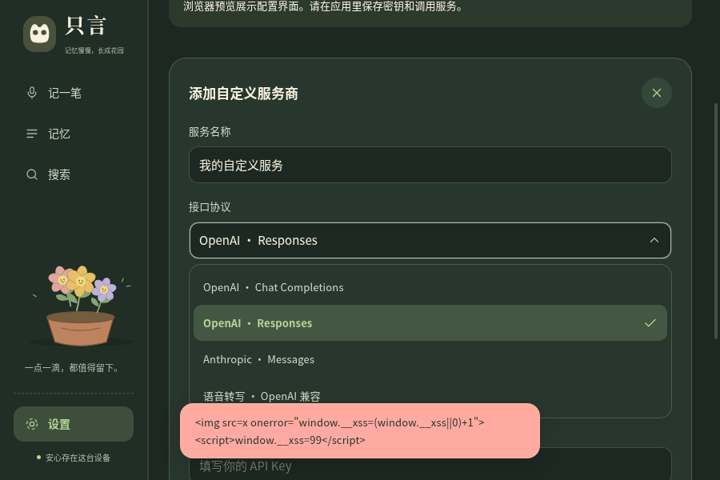
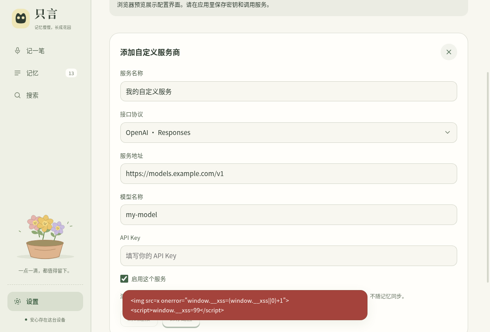
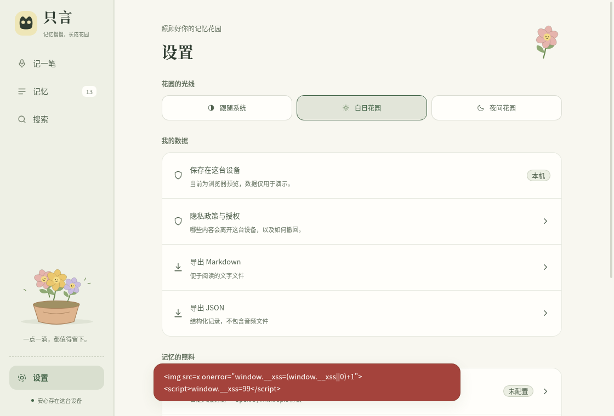

# Visual regression: `origin/feat/t6-privacy-consent` (fa67c8c) → HEAD (8592598)

Same interaction script (prototype/garden-test.js) for both sides. Pixels counted as changed when any channel differs by > 24/255.

| variant | screen | changed pixels | before | after | diff |
|---|---|---|---|---|---|
| proto | ios-home | 0.000% |  |  |  |
| proto | ios-integrations | 0.000% |  |  |  |
| proto | ios-providers | 0.000% |  |  |  |
| proto | ios-sync | 0.000% |  |  |  |
| proto | ios-timeline | 0.000% |  |  |  |
| proto | mac-dark | 0.000% |  |  |  |
| proto | mac-home | 0.000% |  |  |  |
| proto | mac-integrations-dark | 0.000% |  |  |  |
| proto | mac-integrations | 0.000% |  |  |  |
| proto | mac-protocol-menu-dark | 0.000% |  |  |  |
| proto | mac-protocol-menu | 0.000% |  |  |  |
| proto | mac-providers | 0.000% |  |  |  |
| proto | mac-search | 0.000% |  |  |  |
| proto | mac-settings | 0.000% |  |  |  |
| proto | mac-sync | 0.000% |  |  |  |
| proto | privacy | 0.000% |  |  |  |
| app | ios-home | 0.000% |  |  |  |
| app | ios-integrations | 0.000% |  |  |  |
| app | ios-providers | 0.000% |  |  |  |
| app | ios-sync | 0.000% |  |  |  |
| app | ios-timeline | 0.000% |  |  |  |
| app | mac-dark | 0.000% |  |  |  |
| app | mac-home | 0.000% |  |  |  |
| app | mac-integrations-dark | 0.000% |  |  |  |
| app | mac-integrations | 0.000% |  |  |  |
| app | mac-protocol-menu-dark | 0.000% |  |  |  |
| app | mac-protocol-menu | 0.000% |  |  |  |
| app | mac-providers | 0.000% |  |  |  |
| app | mac-search | 0.000% |  |  |  |
| app | mac-settings | 0.000% |  |  |  |
| app | mac-sync | 0.000% |  |  |  |
| app | privacy | 0.000% |  |  |  |

Max changed: **0.000%** across 32 screenshots.
